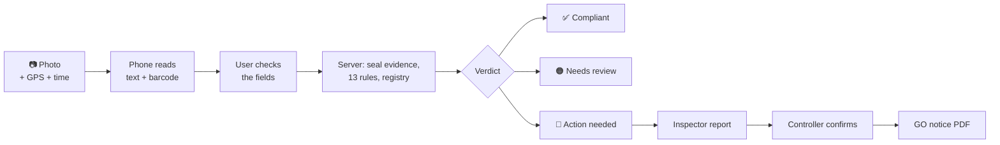

<div align="center">

# LMCS: Legal Metrology Compliance Scanner

**Photograph a packaged product's label. LMCS checks it against the Legal Metrology
(Packaged Commodities) Rules, 2011, cross-checks it with the registered product,
and seals the photo as tamper-evident evidence.**

[](https://github.com/Lokeshraj2006/LMCS/actions/workflows/ci.yml)


Smart India Hackathon 2026 · Problem statement **SIH26034** · Team **HexTech**


</div>

## What it does

- 📷 **One photo, 13 checks.** The phone reads the label (Google ML Kit, on the device) and the server checks maker, quantity, MRP, dates, customer care, font size and more.
- 📏 **The barcode is a ruler.** An EAN-13 barcode is 37.29 mm wide, so letter height is measured in millimetres from an ordinary photo.
- 🔎 **Registry cross-check.** The barcode pulls up the registered product. A raised MRP is flagged as tampering; a lower one is an allowed sticker.
- 🔒 **Evidence that holds up.** Each photo gets a SHA-256 fingerprint, GPS and network time, and the dashboard re-checks the fingerprint every time it is viewed.
- ⚖️ **Honest verdicts.** **Compliant**, **Needs review** or **Action needed**. If the photo can't settle a check it says REVIEW and a person decides, never a guessed pass.
- 🏛️ **People decide.** A consumer's scan raises a complaint, an inspector files a report, and only the Controller confirms it and issues the GO notice. The server enforces this.

## How it works



<div align="center">

<br><sub>The Controller's dashboard: rule catalogue with statutory provisions and on/off switches</sub>
</div>

## Built with

| Part | Folder | Stack |
| --- | --- | --- |
| 📱 Mobile app (consumers, inspectors) | [`mobile/`](mobile/) | Flutter, Google ML Kit |
| 🖥️ Server | [`Backend/`](Backend/) | FastAPI, PostgreSQL, OpenCV, pyzbar, ReportLab |
| 📊 Dashboard (Controller) | [`Frontend/`](Frontend/) | React, Vite, Leaflet |

**Cheap to run:** no GPU and no ML framework. The server takes **0.31 s of CPU per photo** on one core (median over 53 real photos), so a 1 vCPU / 1 GB server is enough.

## Quick start

```bash
docker compose up --build
```

Dashboard at <http://localhost:8080>, API at <http://localhost:8000/docs>. Create the first admin with the command at the top of [`docker-compose.yml`](docker-compose.yml).

Running each part by hand, building the Android app, and troubleshooting are in **[SETUP.md](SETUP.md)**.

## Tests

```bash
cd Backend && python -m pytest tests/ -q     # 352 tests
cd mobile  && flutter test                   # 100 tests
```

GitHub Actions runs both, plus the dashboard build, on every push.

## Learn more

- **[HOW_IT_WORKS.md](HOW_IT_WORKS.md)**: the 13 rules and their provisions, the registry check, why REVIEW is not a violation, and known limitations
- **[SETUP.md](SETUP.md)**: full setup, accounts, API overview, troubleshooting

> **Status:** working prototype, tested end to end on real packs. It is not a production deployment.

<div align="center"><sub>Team HexTech · Smart India Hackathon 2026</sub></div>
