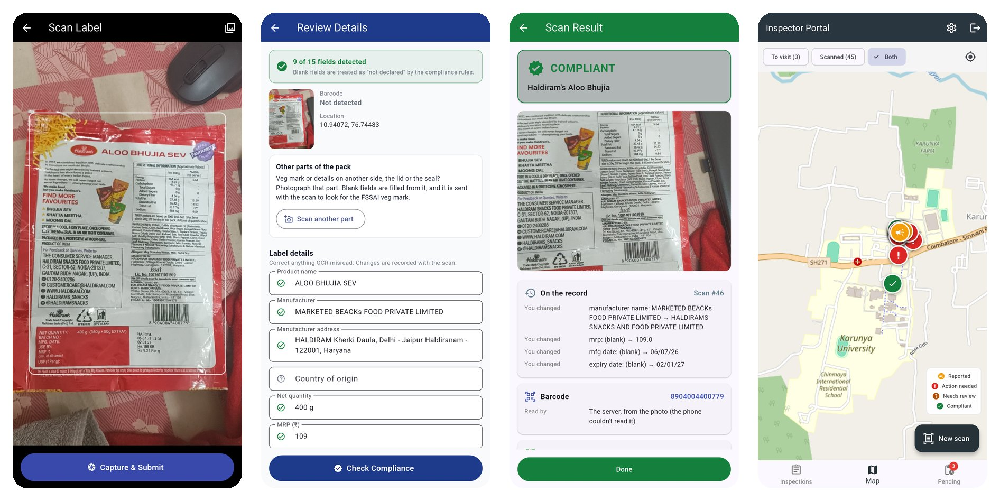
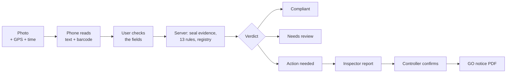
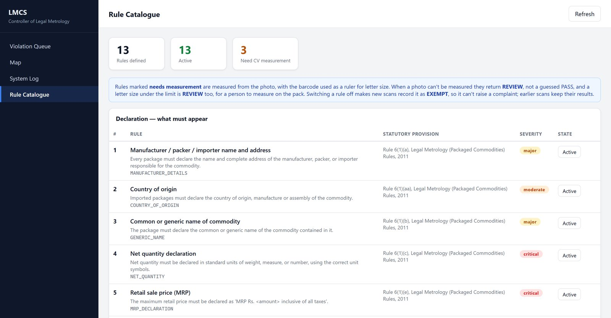

<div align="center">

# LMCS - Legal Metrology Compliance Scanner

**Take one photo of a packed product's label and LMCS tells you if the label follows the
Legal Metrology (Packaged Commodities) Rules, 2011. It also checks the product against the
registered details and keeps the photo safe as proof.**

[](https://github.com/Lokeshraj2006/LMCS/actions/workflows/ci.yml)


Smart India Hackathon 2026 · Problem statement **SIH26034** · Team **HexTech**



</div>

## What it does

- **One photo, 13 checks.** The phone reads the label by itself (Google ML Kit) and the server checks things like the maker's name, quantity, MRP, dates, customer care number and font size.
- **Barcode as a ruler.** An EAN-13 barcode is always 37.29 mm wide, so we use it to measure how big the letters are, straight from a normal photo.
- **Checks with the registry.** Using the barcode, we pull up the registered product details. If the printed MRP is more than the registered one, it is flagged as tampering. A sticker that lowers the MRP is allowed, so that one is fine.
- **Proof that can't be changed.** Every photo gets a SHA-256 fingerprint along with GPS and internet time. The dashboard checks the fingerprint again every time someone opens it.
- **No guessing.** Every scan ends as Compliant, Needs review or Action needed. If the photo is not clear enough to decide, it says REVIEW and a person checks the pack. It never passes something just like that.
- **Officers take the final call.** A consumer's scan raises a complaint, the inspector files a report, and only the Controller can confirm it and send the GO notice. The server itself makes sure of this.
- **Tamil and English.** One tap and the app switches to Tamil. The scan report PDF also comes in whatever language the app is set to (long press the Report button to get the other one).

## How it works



<div align="center">

<br><sub>The Controller's dashboard: all 13 rules with their legal provisions, each with an on/off switch</sub>
</div>

## Built with

| Part | Folder | Stack |
| --- | --- | --- |
| Mobile app (for consumers and inspectors) | [`mobile/`](mobile/) | Flutter, Google ML Kit |
| Server | [`Backend/`](Backend/) | FastAPI, PostgreSQL, OpenCV, pyzbar, ReportLab, PyMuPDF |
| Dashboard (for the Controller) | [`Frontend/`](Frontend/) | React, Vite, Leaflet |

**Cheap to run:** no GPU and no heavy AI model. The server takes around **0.31 seconds of CPU per photo** on a single core (median of 53 real photos), so a small 1 vCPU / 1 GB server is more than enough.

## Quick start

If you have Docker, just run:

```bash
docker compose up --build
```

The dashboard opens at <http://localhost:8080> and the API docs at <http://localhost:8000/docs>. To create the first admin, use the command given at the top of [`docker-compose.yml`](docker-compose.yml).

Want to run each part separately, or build the Android app? Everything is in **[SETUP.md](SETUP.md)**.

## Tests

```bash
cd Backend && python -m pytest tests/ -q     # 363 tests
cd mobile  && flutter test                   # 108 tests
```

GitHub Actions runs all of these, plus the dashboard build, every time we push.

## Learn more

- **[HOW_IT_WORKS.md](HOW_IT_WORKS.md)**: the 13 rules and their legal provisions, the registry check, why REVIEW is not a violation, and what it can't do yet
- **[SETUP.md](SETUP.md)**: full setup, accounts, API list and troubleshooting

> **Status:** This is a working prototype. We have tested it end to end on real packs, but it is not a production deployment yet.

<div align="center"><sub>Team HexTech · Smart India Hackathon 2026</sub></div>
